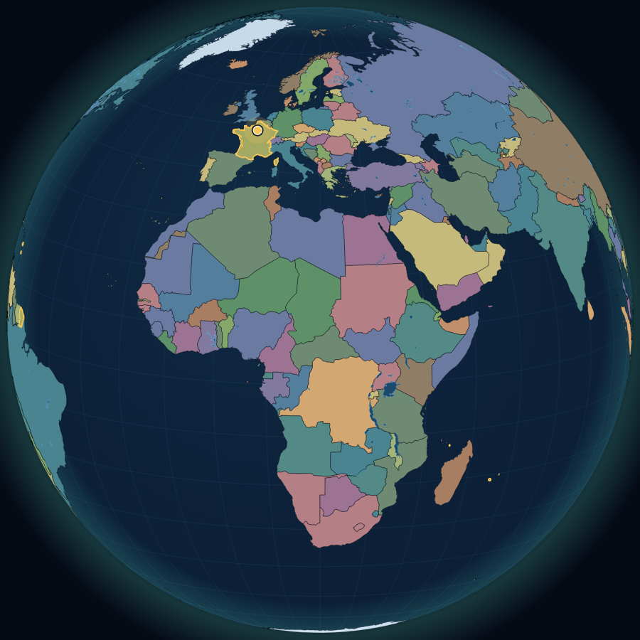
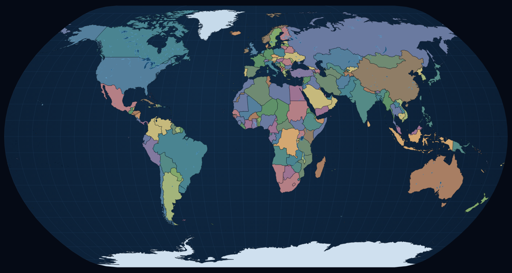
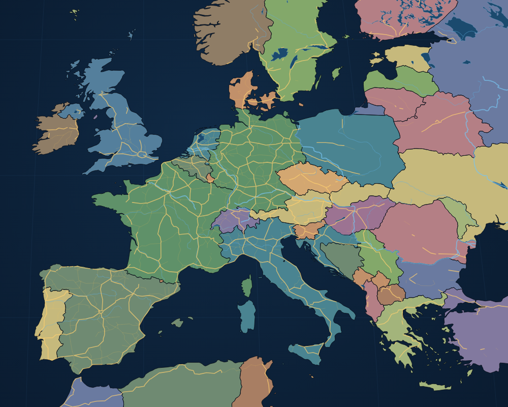
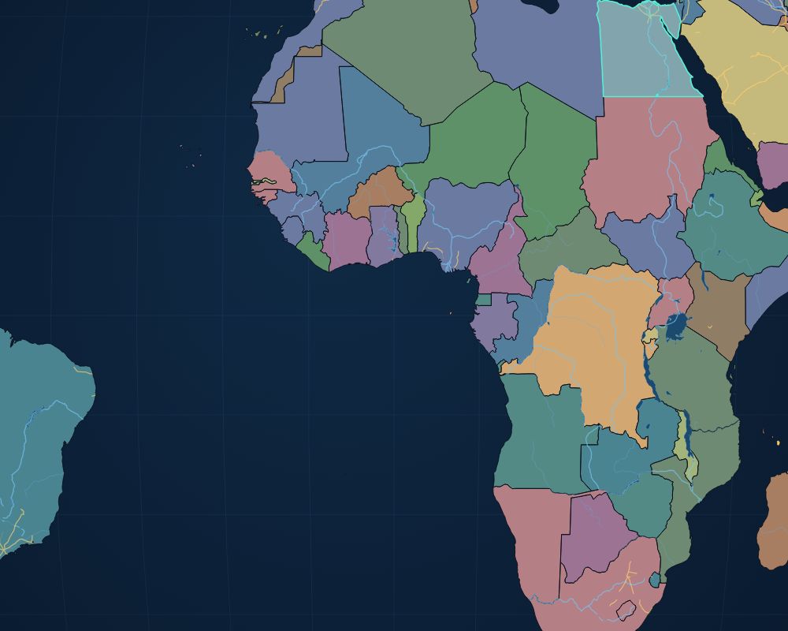

# Voyage Culturel

> Explorer le monde. Répondre. Progresser.

Application web de jeu culturel **en réseau local**, mise en œuvre du dossier de conception :
un **joueur** explore un globe interactif et répond à des questions de géographie et de culture,
un **présentateur** pilote la partie depuis une interface séparée qui contient les réponses,
les indices et les commandes de validation.

- Deux écrans, un seul Wi-Fi, **aucune dépendance à un service cloud** pendant la partie.
- **Carte du monde réelle** : pays colorés, lacs, fleuves, routes, zoom jusqu'au détail régional.
- Le joueur répond **en cliquant sur le pays** : le serveur vérifie le clic et applique le barème.
- 72 questions vérifiées (6 thèmes × 3 niveaux), banque locale au format JSON.
- La réponse attendue n'est **jamais** envoyée au navigateur du joueur avant validation.

---

## Aperçu

| Globe (accueil, rotation automatique) | Carte du monde, pays réels |
| --- | --- |
|  |  |

| Zoom régional : routes, fleuves, lacs, sélection | Verdict : repère du joueur et lieu attendu |
| --- | --- |
|  |  |

Aperçus générés sans navigateur par `npm run preview:map` (voir `docs/DONNEES.md`).

## 1. Démarrage

```bash
npm install
npm run dev          # http://localhost:3000 (écoute aussi sur le réseau local)
```

| Commande | Effet |
| --- | --- |
| `npm run dev` | Serveur local + Next.js en mode développement (HMR) |
| `npm run build` | Compilation de production — **arrêter le serveur de dev avant** |
| `npm start` | Serveur de production (`NODE_OPTIONS=production`) |
| `npm run typecheck` | Vérification TypeScript |
| `npm run smoke` | Test de bout en bout du moteur (voir §8) |

Le port se change avec `PORT=4000 npm run dev`.

> **Vous travaillez dans VS Code ?** Guide pas à pas (clonage, extensions, `F5`, Git, Pull
> Requests, dépannage) : [`docs/VSCODE.md`](docs/VSCODE.md). Configurations prêtes à l'emploi dans
> `.vscode/` : `Ctrl+Shift+B` lance le serveur, `F5` le débogue.

### Utilisation en classe ou en famille

1. Lancer le serveur sur l'ordinateur du présentateur.
2. Ouvrir **`/presentateur`** sur cet ordinateur → *Créer la salle*.
3. Projeter le **code à 5 caractères** ou le **QR code**.
4. Le joueur scanne/ouvre le lien sur son téléphone ou sa tablette, saisit un pseudo.
5. Le présentateur démarre, distribue les indices et valide les réponses.

> ⚠️ Depuis un téléphone, n'utilisez jamais `localhost` : il désigne le téléphone lui-même.
> Utilisez l'adresse du type `http://192.168.x.x:3000` affichée au démarrage du serveur (ou le QR code).
> Le pare-feu de l'ordinateur doit autoriser les connexions entrantes sur le port.

Le QR code est généré **côté serveur** (`GET /api/qr?data=…`) à partir de l'adresse réellement
utilisée dans le navigateur : il fonctionne donc aussi bien en local que derrière un proxy.

---

## 2. Ce qui est implémenté (et où)

| Exigence du dossier | Mise en œuvre |
| --- | --- |
| Écran joueur : rejoindre par code/QR, pseudo, statut | `/jouer` — formulaire, reprise de session, pastille de connexion |
| Globe / carte 3D zoomable, repères, retour à la vue globale | `src/components/WorldMap.tsx` — projection orthographique + carte plate (D3), rotation au doigt, molette/pincement, retour à la vue globale |
| « Colore la terre », pays réels | 241 pays Natural Earth 1:50 m, coloriés comme un atlas, noms français au survol |
| Routes réelles détaillées selon le zoom | Lacs (toujours), rivières dès ×1,35, **routes réelles** (Natural Earth 1:10 m) dès ×2,2, frontières renforcées — voir `docs/DONNEES.md` |
| Réponse par clic sur la carte | Clic → pays détecté (point-in-polygon), confirmation du nom, bouton *Valider ma réponse* |
| Écoute de la question | Synthèse vocale (`speechSynthesis`) ; la dictée a été retirée, la réponse est cartographique |
| Score, niveau, progression, feedback | Barre de niveau, carnet de pays trouvés, panneau de résultat |
| Interface présentateur : créer/démarrer/terminer | `/presentateur` — salle, QR, réglages, commandes |
| Réponse privée, explication, source | Carte dorée « visible par vous seul », variantes acceptées, source |
| Commandes : afficher, répéter, indice, valider, incorrecte, passer, suivante | Barre de commandes + lecture de l'énoncé côté joueur |
| Temps réel | Socket.IO (repli long-polling automatique) |
| Accessibilité / robustesse | Saisie clavier toujours possible, boutons ≥ 46 px, contrastes, `aria-*`, `prefers-reduced-motion`, jeu utilisable sans voix ni WebGL |
| Sécurité / vie privée | Code de salle aléatoire, jeton présentateur, filtrage strict des états envoyés, données en mémoire seulement |

---

## 3. Règles du jeu

| Élément | Valeur par défaut |
| --- | --- |
| Points — facile / moyen / expert | 10 / 20 / 30 |
| Emplacement exact (bon pays, à moins de 400 km du lieu) | 100 % des points |
| Bon pays, mais loin du lieu précis | 60 % |
| À moins de 200 km, de l'autre côté d'une frontière | 40 % |
| Ailleurs | 0 point (résolu en échec) |
| Indice | −5 points (deux indices au plus par question) |
| Seconde chance (option, activée) | la question reste ouverte, la réponse vaut alors la moitié |
| Correction du présentateur | il peut **accorder** ou **retirer** les points après coup |
| Niveaux | 1 → 6 aux scores 0, 40, 100, 170, 260, 360 |
| Fin de partie | score, bonnes réponses, pays trouvés, badge (Apprenti → Explorateur légendaire) |
| Nombre de questions | 5, 8, 10, 12 ou 15 |
| Thèmes | Tous, Capitales, Monuments, Langues, Nature, Traditions, Histoire |
| Difficulté | Facile, Moyenne, Experte, ou **Progressive** (montée en difficulté) |

Le présentateur peut régler thème, difficulté, nombre de questions et seconde chance **avant** le
démarrage ; ces réglages sont figés dès la première question.

---

## 4. Architecture

```
server/
  index.mjs        Serveur HTTP + Next.js + Socket.IO, API /api/health, /api/bank, /api/qr
  rooms.mjs        État des salles, machine à états, barème, vues « présentateur » et « joueur »
  questions.mjs    Chargement et validation de la banque, tirage, distance, niveaux
data/
  questions.json   Banque de 72 questions (source + date de vérification par fiche)
src/app/
  page.tsx         Accueil
  jouer/           Écran joueur
  presentateur/    Console présentateur
src/components/
  WorldMap.tsx     Globe orthographique et carte plate (D3 + TopoJSON, canvas)
  SiteHeader.tsx
src/lib/
  socket.ts        Client Socket.IO, appels avec acquittement, sessions locales
  types.ts         Types partagés des états
  catalog.ts       Thèmes et difficultés pour les formulaires
server/geo.mjs     « Dans quel pays a-t-on cliqué ? » (point-in-polygon sur les frontières réelles)
public/geo/        Natural Earth : pays 1:50 m et 1:110 m, lacs, rivières, routes (voir docs/DONNEES.md)
scripts/smoke.mjs  Test automatisé du moteur
scripts/build-geo.mjs   Régénère les pays traduits en français
scripts/preview-map.mjs Rend les aperçus de la carte en PNG, sans navigateur
docs/DONNEES.md    Provenance des données, licences, niveau de détail
docs/apercus/      Aperçus du rendu (globe, carte du monde, Europe, zoom)
```

### Choix techniques

- **Next.js 15 + React 19 + TypeScript** (pile proposée par le dossier), servi par un **serveur Node
  personnalisé** : c'est lui qui porte Socket.IO et qui écoute sur `0.0.0.0` pour être joignable
  depuis le réseau local.
- **D3-geo + TopoJSON** plutôt que Three.js/WebGL : le globe est rendu en canvas, avec de vraies
  frontières, sans texture à télécharger, sans carte graphique requise et sans licence à vérifier.
  Il reste « rotatif, zoomable, cliquable », et se dégrade proprement sur les appareils modestes.
- **Socket.IO** avec `transports: ['polling', 'websocket']` : indispensable, car beaucoup de proxys
  Wi-Fi d'établissement bloquent les WebSockets.
- **Aucune ressource externe** à l'exécution (polices auto-hébergées via `@fontsource`, géographie
  locale) : une fois la page chargée, le jeu fonctionne hors ligne.

---

## 5. Protocole temps réel

Le serveur diffuse un état **différent** à chaque rôle ; il n'existe pas d'état « complet » partagé.

| Événement | Émetteur | Charge utile |
| --- | --- | --- |
| `host:create` | présentateur | `{theme, difficulty, count, allowRetry}` → `{code, hostToken}` |
| `host:rejoin` | présentateur | `{code, token}` |
| `host:command` | présentateur | `{code, type, payload}` — `start`, `hint`, `correct`, `incorrect`, `skip`, `next`, `end`, `restart`, `config` |
| `player:join` | joueur | `{code, pseudo}` → `{playerId, pseudo}` |
| `player:rejoin` | joueur | `{code, playerId}` |
| `player:submit` | joueur | `{code, text, pin:[lon,lat]}` |
| `state` | serveur | état filtré (`playerView` / `hostView`) |

Les commandes sont refusées si le socket n'est pas celui du présentateur (`room.hostSocketId`),
si la question n'est pas dans le bon état, ou si la partie n'a pas commencé.

---

## 6. Données

Chaque fiche de `data/questions.json` contient : `id`, `theme`, `difficulty` (1-3), `question`,
`answer`, `accepted` (variantes), `hints` (2), `explanation`, `country`, `countryCode`, `isoN`
(code ISO numérique utilisé pour surligner le pays sur la carte), `coords` `[lon, lat]` et
`source {label, url}`.

La date de vérification globale est `checkedAt` et s'affiche dans l'interface. Les sources sont
institutionnelles (UNESCO, Britannica, Larousse, musée du Louvre). Avant d'ajouter des questions,
vérifiez : exactitude, variantes acceptées, coordonnées, code `isoN` (le pays doit exister dans
`public/geo/countries-110m.json`, sinon il n'est simplement pas surligné).

Changer le nombre de questions ou de thèmes ne demande aucune modification de code : la banque est
lue au démarrage du serveur.

---

## 7. Sécurité et vie privée

- Code de salle aléatoire à 5 caractères, **jeton présentateur** secret conservé dans le
  `localStorage` de l'animateur (pas dans l'URL du joueur).
- `playerView()` ne contient la réponse, l'explication, le pays attendu et les coordonnées qu'après
  résolution ; les tests automatisés le vérifient sur le JSON réellement transmis.
- Le serveur tranche les réponses lui-même à partir de la géométrie des pays : le navigateur ne
  reçoit pas le corrigé pour « calculer » le verdict.
- Aucun compte, aucun courriel, aucune donnée persistée : pseudos, scores et historique vivent en
  mémoire et la salle est purgée après inactivité (6 h, 30 min sans aucun appareil connecté).
- Le trafic reste sur le réseau local. Cela ne remplace pas les protections de base : n'exposez pas
  ce serveur sur Internet.

---

## 8. Tests

**Automatique** — `npm run smoke` (serveur démarré) vérifie 33 points : création de salle, mauvais
code refusé, arrivée du joueur, absence de la réponse et du pays attendu dans l'état joueur, indice
unique, refus d'une réponse sans clic, détection d'un mauvais clic, seconde chance, verdict exact,
correction du présentateur (accorder / retirer), passage, fin de partie, reconnexion, jeton
présentateur invalide, commande refusée à un tiers.

**Manuel** — la liste du dossier de conception :

1. Téléphone et ordinateur sur le même Wi-Fi, code erroné, déconnexion/reconnexion.
2. Question, indice, validation et score synchronisés sur les deux écrans.
3. La réponse privée n'apparaît jamais dans l'écran joueur (onglet « Réseau » du navigateur).
4. Zoom et déplacement à la souris **et** au doigt ; réseau lent (le repli long-polling prend le relais).
5. Clic sur un pays voisin : le verdict doit rester « à côté » ; clic dans le bon pays : « bon pays ».
6. Rendu : `npm run preview:map` régénère les aperçus PNG sans navigateur.

---

## 9. Décisions prises (à confirmer)

Le dossier listait plusieurs décisions ouvertes ; les valeurs retenues sont :

- **Un joueur et un présentateur** par salle (MVP). Le modèle de données est prêt pour plusieurs
  joueurs (score et pays suivis par joueur), l'interface devra être étendue.
- **Cartographie** : globe D3 + carte plate, plutôt que Three.js (voir §4).
- **Réponse** : clic sur la carte plutôt que saisie de texte — le jeu teste le repérage géographique,
  pas l'orthographe. Le présentateur garde la main via les corrections.
- **Catégories** : capitales, monuments, langues, nature, traditions, histoire.
- **Barème** : voir §3, tout est réglable côté présentateur (sauf le barème, centralisé dans
  `server/questions.mjs`).
- **Fonctionnement hors ligne** : oui, après chargement de la page.

---

## 10. Limites connues et suites possibles

- Les **routes** Natural Earth sont les grands axes mondiaux : denses en Europe et en Amérique du
  Nord, rares en Afrique subsaharienne. Ce ne sont pas des données OpenStreetMap (bien trop lourdes
  pour un dépôt et pour un rendu temps réel).
- **Un seul joueur** par salle ; pas de mode équipe.
- Tout est en mémoire : un redémarrage du serveur termine les parties en cours (les sessions
  locales permettent au joueur de rejoindre une nouvelle salle sans perdre son pseudo).
- Pistes : sauvegarde SQLite des scores, mode multi-joueurs, mode « atelier » de création de
  questions, fonds de carte régionaux plus fins, vue 3D WebGL (Three.js) pour les machines dotées
  d'une carte graphique.
