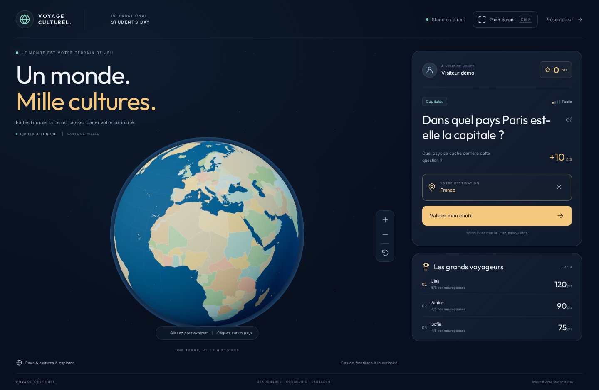
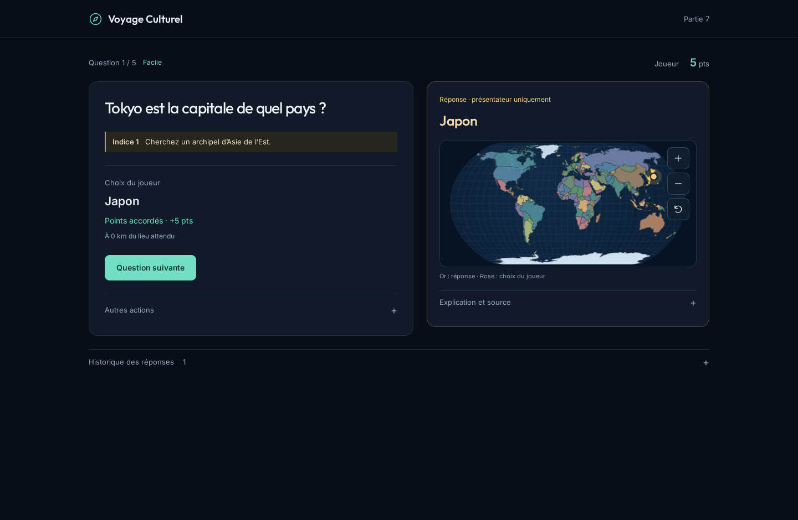

# ALGOMANIA — Le défi géographique

Jeu web du **Scientific Club ALGOMANIA**, conçu d’abord pour un écran tactile **43 pouces ou plus**, avec un pupitre sur ordinateur portable. Interface marine, cyan et blanc, logo du club et véritable globe Three.js aux couleurs naturelles.

**Un stand, un joueur à la fois, aucun compte ni code de salle.** Le nom et le prénom sont obligatoires dans **un seul champ** avant de jouer ; ils ne constituent pas un système de connexion.

## Les deux écrans

| Écran visiteur                                                    | Pupitre sur ordinateur                                                                      |
| ----------------------------------------------------------------- | ------------------------------------------------------------------------------------------- |
|  |  |

[Vue tactile 4K](docs/apercus/interface-4k.png) · [Clavier de nom complet](docs/apercus/interface-clavier.png) · [Veille](docs/apercus/interface-veille.png) · [Mobile](docs/apercus/interface-mobile.png).
Les noms et scores de ces captures sont **fictifs** ; aucune donnée de démonstration n’est injectée dans le fichier des visiteurs réels.

- **`/jouer`** : veille, entrée du nom, globe, questions, progression et résultat.
- **`/presentateur`** : partie courante, réponse et indices privés, commandes, réglages et classement détaillé.
- **`/`** redirige vers `/jouer`.
- **Ctrl+F** active/désactive le plein écran ; un bouton tactile est également présent. Un refus du navigateur est expliqué sans bloquer le jeu.

## Démarrer

Prérequis : **Node.js 22+**, npm, Git. Dans le dossier du dépôt :

```powershell
npm ci --include=dev
npm run dev
```

Deux processus distincts sont lancés :

| Service | Adresse locale          | Fonction                                               |
| ------- | ----------------------- | ------------------------------------------------------ |
| Next.js | `http://localhost:3000` | Les deux interfaces et le proxy HTTP/WebSocket         |
| Express | `http://localhost:4000` | Moteur, validation, tirages, score, JSON et temps réel |

1. Ouvrir **`http://localhost:3000/presentateur`** sur le laptop de l’animateur.
2. Ouvrir **`http://localhost:3000/jouer`** sur le grand écran.
3. Le visiteur touche l’écran, appuie sur **Jouer**, puis saisit son **nom et prénom dans le même champ**.
4. Le clavier tactile AZERTY propose les accents, les majuscules, l’espace, l’apostrophe, le trait d’union et l’effacement ; un clavier arabe est aussi intégré. Le clavier physique fonctionne également.
5. Le visiteur tourne la Terre, sélectionne un pays puis valide. Le serveur détermine si ce pays est correct.
6. Après le verdict, le visiteur ou l’animateur ouvre la question suivante. À la fin des quatre niveaux, le résultat est enregistré et le visiteur peut rejouer ou laisser la place.

Sur un deuxième appareil, utiliser **l’IP du PC serveur**, par exemple `http://192.168.1.20:3000/jouer`, pas `localhost`. Les appareils doivent partager le même réseau et le pare-feu doit autoriser le port 3000. Aucun service Internet n’est nécessaire pendant le jeu : cartes, images, polices, questions et faits sont locaux. Les liens de références restent facultatifs et nécessitent Internet.

Les requêtes du navigateur utilisent uniquement l’origine du frontend. Next relaie `/api/*` et `/socket.io` vers Express ; ne pas ajouter d’URL `localhost:4000` dans le code navigateur. Le backend n’a pas besoin d’être exposé aux visiteurs.

## Veille et parcours visiteur

- Après **10 secondes sans interaction**, **uniquement sans partie active**, l’accueil ou la saisie cède la place à la veille.
- La veille conserve la marque en haut, fait tourner doucement le globe et choisit un pays puis un fait au hasard toutes les **9 secondes**.
- Les informations apparaissent dans un encart discret. Le bouton de pause suspend rotation et changement des faits ; la préférence système de réduction des mouvements est respectée.
- Un toucher affiche le fond légèrement assombri et le bouton **Jouer**. Pas de salle à créer/rejoindre ni de formulaire de réponse écrite.
- Un **nom déjà connu** demande explicitement **Rejouer avec ce nom** ou **Écrire un autre nom**, avant de créer une tentative.
- Une partie active n’est jamais interrompue par la veille, même si le joueur prend le temps de réfléchir.

Le globe occupe environ **70 % de la largeur du viewport de jeu**. Le classement est en haut à gauche, le nom, le score, les réponses et les quatre niveaux sont à droite, avec la question et la validation. Sur petit écran, les panneaux se réorganisent verticalement.

### Sélection accessible, sans réponse textuelle

Glisser pour tourner, pincer/molette ou boutons pour zoomer, toucher pour choisir. Au clavier sur le globe : flèches pour explorer, Entrée pour sélectionner, `+`/`−` pour zoomer. **Choix au clavier** ouvre une liste de pays, sélectionne leur repère sur le globe et facilite l’accès aux petits territoires. Il ne s’agit pas d’un champ de réponse à écrire.

## Règles et pupitre

Quatre niveaux : **Facile → Moyen → Difficile → Expert**.

| Réglage/règle                           | Comportement                                                           |
| --------------------------------------- | ---------------------------------------------------------------------- |
| Longueur par défaut                     | **3 questions par niveau**, soit **12** au total                       |
| Longueur réglable                       | 2 à 10 questions par niveau, soit 8 à 40 au total                      |
| Points                                  | 10 / 20 / 30 / 40 selon le niveau ; maximum par défaut : 300           |
| Réponse fausse                          | 0 point ; question résolue, sauf seconde chance activée                |
| Indices                                 | Deux au maximum, −5 points chacun, minimum 5 pour une réponse juste    |
| Seconde chance                          | Désactivée par défaut ; moitié des points restants arrondie, minimum 5 |
| Océan/coordonnées invalides/ancien tour | Refus sans consommer de réponse                                        |
| Remplacer la question                   | Nouvelle question du même niveau, **sans score ni progression**        |
| Corriger le verdict                     | Accepter/refuser le dernier verdict, sans double attribution de points |
| Terminer ce passage                     | Arrêt anticipé confirmé, points conservés et tentative enregistrée     |
| Prêt pour le prochain visiteur          | Retour au stand, **pas une suppression du classement**                 |

Le tirage choisit **d’abord un pays équiprobable, puis une question de ce pays** au niveau courant. Les questions déjà tirées sont évitées jusqu’à épuisement du groupe disponible. Un remplacement exclut au moins la question remplacée et remet indices et seconde chance à zéro.

### 33 pays ou monde entier

Le pupitre propose :

- **Sélection du club** : 33 pays répartis entre Afrique, Europe, Asie, Amériques et Océanie. La sélection proposée est **modifiable** : décocher un pays puis cocher son remplaçant. La sauvegarde impose exactement 33 IDs distincts et connus.
- **Monde entier** : les **240 pays et territoires cartographiés**, pas uniquement les États souverains.

Pour comparer les scores, conserver la même longueur et le même mode pendant une compétition : les points sont bruts, non normalisés.

Les réglages sont persistés dans `data/settings.json` et ne s’appliquent **qu’à la prochaine tentative**. La partie en cours conserve son propre snapshot des règles et des 33 pays. Les modifications ne changent donc pas le terrain du joueur au milieu de sa partie.

## Profils, tentatives et classement

- Un profil par **nom normalisé** : Unicode, espaces et casse sont traités de façon cohérente. Les accents sont conservés. Les noms internationaux sont acceptés ; le logiciel ne vérifie pas une identité civile.
- **Chaque démarrage confirmé crée une tentative distincte**, conservée même sans réponse ou après un arrêt anticipé.
- Chaque réponse résolue conserve l’ID de la question, le pays attendu/sélectionné, le point cliqué, le niveau, les points, les indices, le nombre d’essais et la date.
- **Une seule ligne au classement par personne**, correspondant à sa meilleure tentative achevée ou arrêtée ayant au moins une réponse. Une tentative en cours n’efface pas le précédent meilleur score.
- Tri : score, bonnes réponses, niveau atteint, date puis ID. Les colonnes questions/niveau sont celles de la meilleure tentative.
- Public : les 20 premiers résultats, dont les 5 premiers sur le grand écran. Pupitre : jusqu’à 100 lignes, nombre total de tentatives et consultation des 50 résumés les plus récents. Le JSON garde l’historique complet.
- Un même nom normalisé représente un même profil. Des homonymes qui veulent des résultats séparés doivent choisir un libellé distinct via **Écrire un autre nom**.

### Persistance et reprise

`data/users.json` est créé automatiquement. Chaque mutation est sérialisée : clone → validation → fichier temporaire → remplacement atomique → commit mémoire → diffusion. Un échec conserve l’état précédent ; un JSON corrompu n’est **jamais réinitialisé silencieusement**.

La question active, son identifiant public opaque, le tour global, les indices, les essais et le snapshot de règles sont sauvegardés côté serveur. Après un redémarrage avec une banque compatible, la partie reprend. Ne pas exécuter deux backends sur le même fichier JSON.

L’ancien schéma v1 est migré automatiquement vers v2, avec une copie privée exacte `users.json.v1.<timestamp>.bak`. Tous les anciens scores sont archivés ; leurs réponses individuelles, absentes du v1, ne sont pas inventées. Sauvegarder les données avant toute mise à jour majeure.

## Confidentialité et limites de sécurité

Le joueur reçoit une question avec un **ID opaque**, pas l’ID interne qui contient parfois le code du pays. Avant résolution, pas de réponse attendue, de coordonnées de réponse, d’explication ni de source du corrigé dans le snapshot joueur. Un indice ne publie que son texte. L’ack de seconde chance contient seulement `ok`/`retry`.

La banque n’est ni dans `frontend/public`, ni dans le bundle navigateur, ni accessible par une API de questions. Le pupitre reçoit son état privé séparément. React Query utilise les clés `['current-question', 'player']` / `['current-question', 'presenter']`, des caches privés distincts et une garde de révision contre les réponses HTTP retardées. Les caches privés sont retirés à la révocation ou au démontage du pupitre.

> **LAN de confiance, sans authentification.** Le premier onglet présentateur prend la main automatiquement. Une capacité opaque, conservée dans son `sessionStorage`, protège ses commandes et permet la reconnexion sans code à saisir. Un autre onglet sans capacité ne peut pas le remplacer tant qu’il est connecté. Fermer le pupitre libère le contrôle. Ce mécanisme n’est **pas** une authentification pour un déploiement Internet public ; l’URL du pupitre ne doit pas être distribuée au public. Le nom saisi n’est pas une preuve d’identité.

Les noms sont affichés au classement du stand ; le formulaire le précise. Garder `users.json`, ses sauvegardes et `settings.json` privés. Définir avec le club une durée de conservation et supprimer/archiver les données après l’événement selon ses règles. Les fichiers locaux sont ignorés par Git.

## Architecture TypeScript

```text
backend/src/             Express, Socket.IO, moteur, tirages, réglages et transactions JSON
frontend/src/app/        /jouer, /presentateur, layout et styles ALGOMANIA
frontend/src/components/ Globe, secours 2D, clavier tactile, question, classement, réglages
frontend/src/hooks/      Query hooks, connexion temps réel, veille et gestion du focus
frontend/src/lib/        API, QueryClient, géodonnées et configuration du globe
frontend/public/        Logo, textures 2K/4K/8K, frontières et routes locales
shared/                 Contrats, règles par défaut et picking géographique commun
scripts/                Orchestration, génération de données et smoke, en .ts
data/countries.json     Catalogue par ID et noms français
data/questions.json     1080 questions dans byCountry[countryId]
data/facts.json         942 faits de veille sourcés pour les 240 pays/territoires
data/users.example.json Schéma v2 vide versionné
data/settings.example.json Réglages par défaut versionnés
data/users.json         Profils, tentatives, réponses et session privée — local, ignoré
data/settings.json      Réglages persistés — local, ignoré
tests/                  Tests de règles, données, réseau, React Query et navigateur
```

Tous les fichiers de **code source** sont `.ts` ou `.tsx`, en mode strict et sans `allowJs`. JSON, CSS, images et documentation gardent leur format naturel. Le JavaScript généré est ignoré.

### Globe et optimisation

- Sphère Three.js/WebGL, éclairage, frontières réelles, marqueurs et picking par raycast.
- Image terrestre locale **2K** au premier affichage, puis **4K**, ou **8K** sur grand viewport compatible ; pas de couleurs arbitraires attribuées aux pays.
- Géométrie 110m légère puis **50m** pour les 240 pays. Ce sont des échelles cartographiques, **pas des mètres de précision**.
- Vraies routes **Natural Earth 10m**, chargées seulement au premier zoom rapproché. Pas de couche vectorielle de fleuves ou lacs ; l’image naturelle montre évidemment les surfaces d’eau.
- Atlas composé une fois, rendu à la demande pendant le jeu ; rotation lente plafonnée en veille, arrêt hors écran/onglet caché. DPR, anisotropie et maillage plafonnés.
- Recentrage par interpolation sphérique, sans traverser la Terre ; libération des ressources au démontage.
- **Secours 2D cliquable et accessible au clavier** si WebGL est indisponible/perdu ; bouton pour réessayer la 3D.

Aucune accélération RTX spécifique n’est requise ou revendiquée. Vérifier les performances sur le navigateur, la résolution et le matériel réels du stand.

## Commandes et tests

| Commande               | Fonction                                                                       |
| ---------------------- | ------------------------------------------------------------------------------ |
| `npm run dev`          | Express et Next séparés, rechargement automatique                              |
| `npm run typecheck`    | Backend, frontend, contrats, scripts et tests, TypeScript strict               |
| `npm test`             | Données, géométrie, règles, persistance, réseau, cache et surveillance Windows |
| `npm run smoke`        | HTTP et vrais WebSockets sur des JSON temporaires isolés                       |
| `npm run test:ui`      | Playwright : laptop, mobile et tactile 1080p/4K, serveur de test isolé         |
| `npm run build`        | Compilation de production des deux workspaces                                  |
| `npm start`            | Démarrage de production après compilation                                      |
| `npm run build:geo`    | Régénération des frontières et du catalogue depuis world-atlas                 |
| `npm run build:data`   | Régénération des 960 repères et des faits depuis une référence figée           |
| `npm run format:check` | Vérification Prettier                                                          |

Arrêter le développement avant de compiler, pour ne pas partager `.next` entre dev et build :

```powershell
npm run build
npm start
```

Installer Chromium une fois pour les tests navigateur :

```powershell
npx playwright install chromium
npm run test:ui
```

**Les tests UI utilisent leurs propres ports 3100/4100, des JSON temporaires et `frontend/.next-ui`.** Ils ne réutilisent pas automatiquement le serveur du stand et ne modifient pas ses visiteurs. `UI_BASE_URL` permet de cibler explicitement un serveur de **test** déjà isolé, jamais le stand réel. Les vérifications automatiques ne remplacent pas une recette tactile sur le 43 pouces.

### Windows / PowerShell 5.1

Commandes séparées, sans `&&` :

```powershell
$env:PORT = "3000"
$env:BACKEND_PORT = "4000"
npm run dev
```

`PORT` vaut 3000 et `BACKEND_PORT` 4000. En production, définir les mêmes variables **avant `npm run build` et avant `npm start`**, car les réécritures du frontend sont compilées. `BACKEND_ORIGIN` peut remplacer l’origine interne du proxy ; `USERS_FILE` et `SETTINGS_FILE` acceptent des chemins absolus privés.

Le périmètre Watchpack est limité au dépôt pour éviter la surveillance des fichiers système ou des dossiers parents. Ne pas modifier des fichiers système Windows pour résoudre un problème de watcher.

## Données, crédits et VS Code

- [Schémas, tirage, migration et cartographie](docs/DONNEES.md).
- [Crédits et licences des données, textures et polices](docs/CREDITS.md).
- [VS Code : **Clone, Pull, Merge**, débogage et PowerShell](docs/VSCODE.md).

La banque comprend **120 questions éditoriales conservées** et **960 questions de repérage générées** pour couvrir chaque pays aux quatre niveaux. Les faits/capitales/codes proviennent d’un référentiel figé ; la présence d’un lien et `checkedAt` ne signifient pas qu’une nouvelle vérification éditoriale de chaque référence a été effectuée. Faire relire les données avant l’événement et enrichir la banque sans remplacer silencieusement les IDs historiques.
